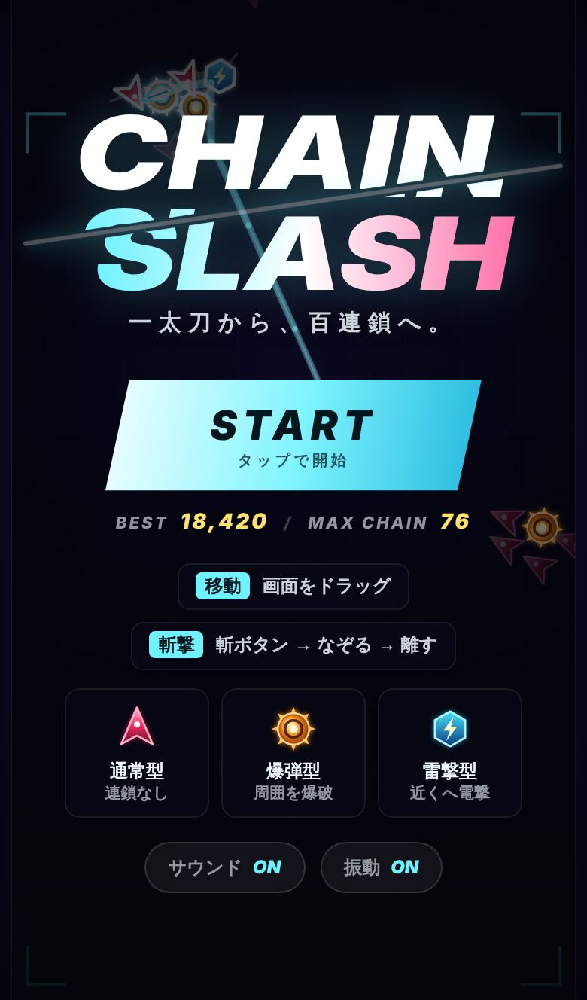
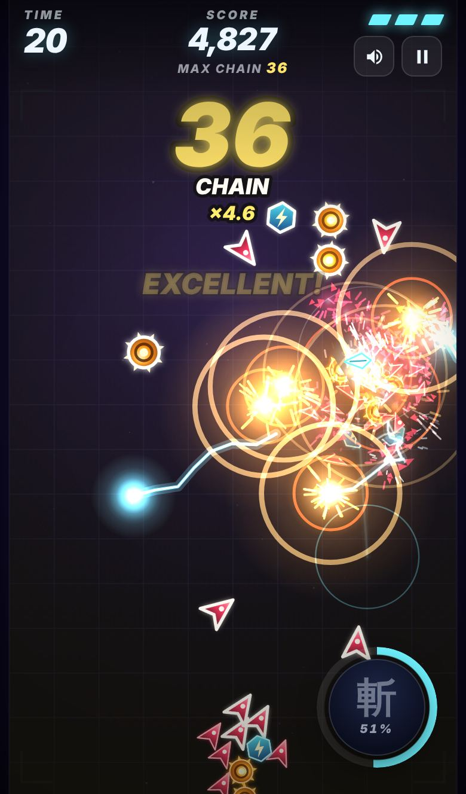

# CHAIN SLASH

**一太刀から、百連鎖へ。**

迫る敵の群れを避けながら、時間を止めて一筆の斬撃ルートを描く。
斬った敵を起点に爆発・電撃が連鎖し、一度の入力で大量撃破を狙う
スマホ縦画面向け・60秒スコアアタックアクション。

 

- HTML5 Canvas 2D ＋ Vanilla JavaScript（ES Modules）、ビルド不要
- 効果音・BGMはすべて Web Audio API でコード生成（音声ファイルなし）
- 外部サーバー・ログイン・広告・解析SDKなし。自己ベストと設定は端末内（localStorage）に保存
- GitHub Pages にそのまま置けば動く静的サイト

---

## 遊び方

| 操作 | 内容 |
| --- | --- |
| 移動 | 画面のどこでもドラッグ（触れた位置が中心の仮想スティック） |
| 時間停止 | 右下の **斬** ボタン（ゲージ満タン時のみ） |
| 斬撃 | 時間停止中に画面をなぞる → 指を離すと発動（タップだけなら一直線に斬る） |
| もう一つの描き方 | 斬ボタンを押したまま引っぱると、自機から同じ方向へルートが伸びる |
| 解除 | 何も描いていない状態で斬ボタンを再タップ |

- 時間停止は最大 **3秒**。時間切れになると、描きかけのルートで自動発動します。
- ルートは **曲がり角2回まで**、総延長に上限あり（先端のリングが残り長さ）。
- 斬撃のダッシュ中は無敵。**3回被弾** でゲームオーバー、生き残れば **60秒** で終了。

### 敵

| 敵 | 形 | 倒したときの効果 |
| --- | --- | --- |
| 通常型 | 赤い矢じり | 連鎖なし（数と得点の源） |
| 爆弾型 | オレンジのトゲ球 | 周囲の一定半径を爆破 |
| 雷撃型 | 青い六角形（稲妻マーク） | 近くの敵へ電撃が最大4回伝播 |

連鎖で倒された敵も自分の効果を発動します。**「何体を直接斬るか」より「どの敵を起点にするか」** が勝負。
時間停止中は特殊敵が強調され、ルート上の爆弾型・雷撃型は連鎖が届く範囲が点線で表示されます。

### スコア

- 基礎点：通常型 10点 / 爆弾型・雷撃型 20点
- 連鎖倍率：`1 + min(連鎖数 ÷ 10, 4)`（最大 ×5）
- 連鎖するほど斬撃ゲージが追加回復（1回の斬撃につき上限 50%）

### 1プレイの流れ

| 時間 | 展開 |
| --- | --- |
| 0〜10秒 | 通常型が接近、最初の爆弾型・雷撃型が登場（初回は頭上に説明ラベル） |
| 10〜30秒 | 爆弾型と雷撃型の混成集団 |
| 30〜50秒 | 密度と速度が上昇、包囲陣形も出現 |
| 50〜60秒 | **RUSH** ― 3方向から大群が押し寄せ、敵は最大120体に。百連鎖のチャンス |

---

## ローカルで動かす

ES Modules を使っているため、`file://` で直接開くのではなくローカルサーバー経由で開いてください。

```sh
# どれか1つ
python3 -m http.server 8000
npx serve .
```

→ <http://localhost:8000/> をブラウザで開く。
同じWi-Fiのスマホから `http://<PCのIPアドレス>:8000/` を開けば実機でも確認できます（音声は HTTPS / localhost 以外だと制限される端末があります）。

PCではキーボードでも遊べます：矢印キー / WASD で移動、Space で時間停止、マウスでルートを描く、Esc でポーズ。

## GitHub Pages で公開する

1. このリポジトリを GitHub に push する（公開リポジトリ）
2. **Settings → Pages → Build and deployment → Source: Deploy from a branch**
3. Branch に公開したいブランチ（例：`main`）と `/ (root)` を選んで **Save**
4. 数分後、`https://<ユーザー名>.github.io/<リポジトリ名>/` で遊べます

更新はブランチへ push するだけ。反映後にスマホで動作を確認してください。
`manifest.webmanifest` を同梱しているので、ホーム画面に追加すると全画面で起動します。

## ディレクトリ構成

```
index.html             画面の骨組み（HUD・タイトル・リザルト）
style.css              UIのスタイル
manifest.webmanifest   ホーム画面追加用
assets/                アイコン・スクリーンショット
src/
  main.js              起動・レイアウト・メインループ・解像度の自動調整
  game.js              ゲーム本体（状態遷移・斬撃・連鎖・スポーン・描画）
  slash.js             指の軌跡 → 折れ線ルート変換、当たり判定
  enemies.js           敵の種類・スプライト・移動（空間分割で近傍探索）
  effects.js           パーティクル・閃光・電撃・画面揺れなどの演出
  audio.js             効果音とBGM（Web Audio API）
  input.js             タッチ / マウス / キーボード入力
  ui.js                HUD・リザルトなどDOMの更新
  config.js            調整用パラメータ（企画書「最初に決める数値」）
  storage.js           自己ベスト・設定の保存
  utils.js             数学ヘルパー
```

## 調整（プレイテスト用）

数値はほぼすべて `src/config.js` に集約しています。

| パラメータ | 値 | 場所 |
| --- | --- | --- |
| 1ラン | 60秒 | `CFG.RUN_TIME` |
| 斬撃思考時間 | 3秒 | `CFG.SLASH_THINK_TIME` |
| 斬撃ゲージ自然回復 | 約8秒 | `CFG.GAUGE_REFILL_TIME` |
| ルートの曲がり角 | 2回 | `CFG.SLASH_MAX_CORNERS` |
| ルートの総延長 | 640 | `CFG.SLASH_MAX_LEN` |
| 同時敵数 | 通常は最大66体、RUSH中のみ120体 | `PHASES` の `cap` / `CFG.MAX_ENEMIES` |
| 連鎖処理 | 1発動につき200件 | `CFG.MAX_CHAIN_EVENTS` |
| ヒットストップ | 90ms | `CFG.HITSTOP` |
| 出現テーブル | 時間帯ごと | `PHASES` / `OPENING` |

URL に `?debug` を付けると FPS・敵数・粒子数が表示され、リザルトに初回斬撃までの秒数と斬撃回数が出ます（企画書「検証する主要指標」の手動計測用）。

## 実装メモ（企画書の要件との対応）

- **斬撃の演出順**：細い軌跡（ダッシュ）→ 一瞬の溜め → 強い閃光＋ヒットストップ 90ms → 切断面に沿って敵が真っ二つ → 爆風・電撃が順番に伝播
- **連鎖の安全性**：各敵の効果は撃破時に1度だけ。予約済みの敵は再予約しない（二重得点なし）。世代数と処理数に上限
- **移動と斬撃の分離**：斬撃モード中は移動を停止し、画面を暗転＋四隅のフレームで明確にUIを切り替え
- **スマホ対応**：safe-area-inset を考慮、`touch-action` とイベント抑止でスクロール・拡大を防止、画面回転時は入力を再初期化、横向きは縦向きを案内
- **負荷対策**：Canvas 内部解像度は DPR 2 まで、重い端末では自動で段階的に下げる。粒子数上限、スプライトの事前描画、空間分割グリッド
- **音**：最初のタップで AudioContext を開始。時間停止中は BGM にローパスがかかり、連鎖のたびに音程が上がる。ミュートはHUD・タイトル・ポーズから
- **アクセシビリティ**：敵は色だけでなく形とアイコンでも識別。振動はオフにできる

## ライセンス・素材

画像・音声素材は使用していません（すべてコードで描画・生成）。
